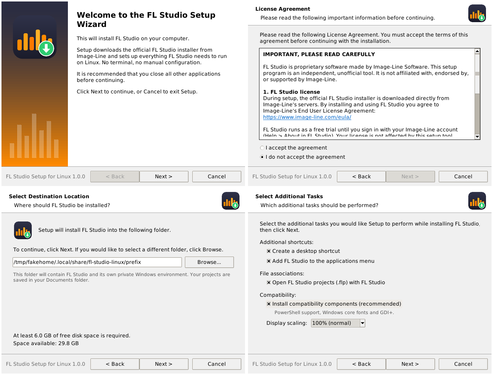
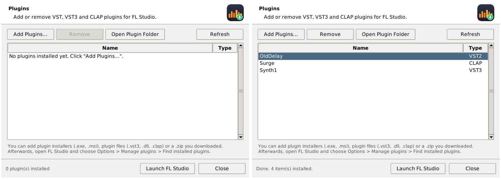
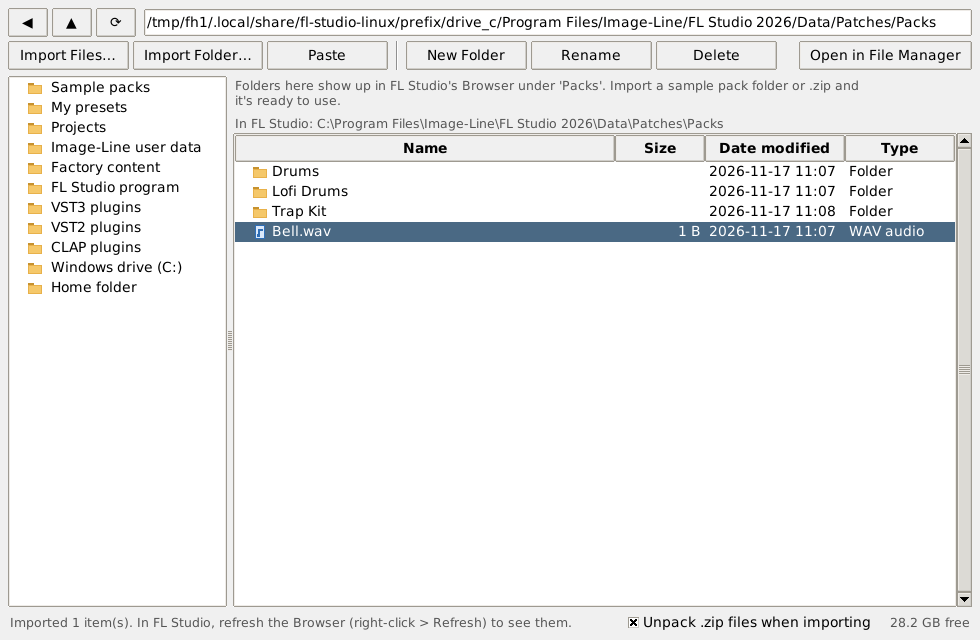
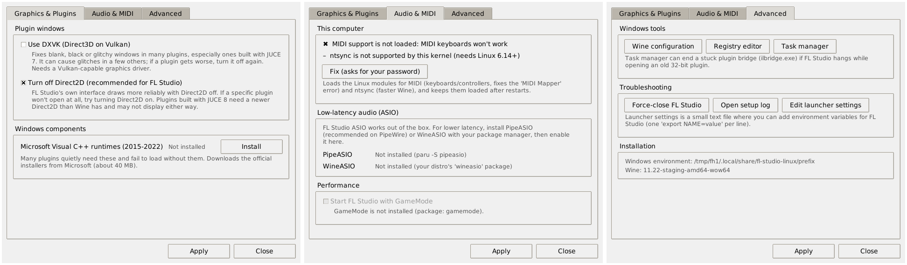

# FL Studio Setup for Linux

**Install FL Studio on Linux the way you would on Windows:** download one file, double-click it, click *Next* a few times. No terminal, no Wine knowledge, nothing to install system-wide.

[](https://github.com/Cazinya/Fl-Linux-Installer/actions/workflows/build.yml)



## Download

Grab **[FL-Studio-Setup-x86_64.AppImage](https://github.com/Cazinya/Fl-Linux-Installer/releases/latest/download/FL-Studio-Setup-x86_64.AppImage)** from the latest release, then:

```bash
chmod +x FL-Studio-Setup-x86_64.AppImage
./FL-Studio-Setup-x86_64.AppImage        # or double-click it in your file manager
```

## What it does

The wizard goes Welcome → License → Install location → Additional tasks → Installer source → Ready → Install → Finish, just like a Windows installer. Behind the scenes it:

1. Downloads a private **Wine 11.22 Staging (WoW64)** runtime. You don't need system Wine or 32-bit libraries.
2. Downloads the **official FL Studio installer** from Image-Line. The download resumes if it's interrupted, and you can also use an installer you already have.
3. Creates FL Studio's own Windows environment (Windows 10 mode, display scaling, Direct2D fix).
4. Installs Microsoft's core fonts with a bundled `cabextract`.
5. Opens FL Studio's own installer for you to click through. Setup never hangs on leftover programs.
6. Applies community fixes:
   - a font for the ♯/♭ note names
   - an `flstudio://` link handler, so signing in through your browser returns to FL Studio
   - a launcher that avoids a known splash-screen hang
7. Adds an app-menu entry, a desktop shortcut and the `.flp` file association, using FL Studio's real icon.

Run the AppImage again, or open **FL Studio Setup** from your app menu, to **Update, Repair or Uninstall**. Uninstalling keeps your projects unless you choose otherwise.

## After installing

| What | Where |
|---|---|
| Start FL Studio | App menu, desktop icon, double-click a `.flp`, or `fl-studio` in a terminal |
| **Plugins** | **FL Studio Plugins** in the app menu, or right-click a plugin installer or zip → *Open With → FL Studio Plugins*. It handles `.exe`/`.msi` installers, `.vst3`/`.dll`/`.clap` files and `.zip` archives, and lists and removes installed plugins. |
| **Sample packs & presets** | **FL Studio Files**: an Explorer-style browser with shortcuts to Sample packs (FL's *Packs* folder), My presets, Projects, factory content and the plugin folders. Import files, folders or `.zip` packs, or copy files in your file manager and press Ctrl+V. |
| **Fix plugins, MIDI, latency** | **FL Studio Setup → Settings…**: DXVK on/off, Direct2D on/off, Visual C++ runtimes, core fonts, GDI+, a one-click MIDI + ntsync fix, PipeASIO/WineASIO, GameMode, Wine tools |
| Wine tools | `fl-studio --winecfg`, `--regedit`, `--taskmgr`, `--kill`, `--run-exe file.exe` |

| Plugins | Files | Settings |
|---|---|---|
|  |  |  |

## Known limitations

- **Plugins built with JUCE 8** usually show a black window. They need a newer Direct2D than Wine currently has.
- **Plugins built with JUCE 7** often need **DXVK** (turn it on in Settings).
- **Copy-protected plugins** (iLok/PACE) generally don't work under Wine.
- **FL Studio 26.1.4 and newer** may refuse to start ("validity of the program could not be verified") until a pending Wine fix lands. If that happens, install an older version with *Use an installer I already downloaded*.
- If FL shows a **"MIDI Mapper"** error or doesn't see your MIDI keyboard, use **Settings → Audio & MIDI → Fix**.

## Where things go

- `~/.local/share/fl-studio-linux/`: Wine runtime, Windows environment (`prefix/`), a copy of Setup, `setup.log`
- `~/.local/bin/fl-studio`: launcher script. Extra environment variables go in `~/.local/share/fl-studio-linux/launcher.env`.
- `~/.local/share/applications/fl-studio-linux*.desktop`: menu entries
- `~/Documents/Image-Line`: your projects and settings (FL Studio's *Documents* folder)

Everything goes in your home folder. The only action that ever needs your password is the optional MIDI/ntsync fix, which loads two kernel modules.

## Building from source

On any x86_64 Linux with `curl`, `git`, `gcc`, `python3` and `squashfs-tools`:

```bash
bash scripts/build.sh      # -> dist/FL-Studio-Setup-x86_64.AppImage
```

The first run downloads its dependencies into `deps/`: a relocatable Python with Tk from [python-appimage](https://github.com/niess/python-appimage), and [appimagetool](https://github.com/AppImage/appimagetool). It also compiles a static [cabextract](https://github.com/kyz/libmspack). Every push is built by GitHub Actions. Pushing a tag such as `v1.2.0` publishes a release with the AppImage attached.

Code layout (`src/flsetup/`):

| File | Purpose |
|---|---|
| `ui.py` | Setup wizard, maintenance page, plugin manager |
| `engine.py` | Install steps: downloads, Wine prefix, FL installer, uninstall |
| `tweaks.py` / `settings.py` | Compatibility tweaks and the Settings window |
| `files.py` | The FL Studio Files browser |
| `plugins.py` | Plugin install, list and remove |
| `integration.py` | Launcher, menu entries, icons, MIME types |
| `peicon.py` | Extracts FL Studio's icon from `FL64.exe` |

Runtime overrides: `FLSETUP_WINE_URL`, `FLSETUP_WINE_VERSION`, `FLSETUP_FL_URL`, `FLSETUP_DXVK_VERSION`, `FLSETUP_EXTRA_CA`.

## Credits

[Wine](https://www.winehq.org/), [Kron4ek's Wine builds](https://github.com/Kron4ek/Wine-Builds), [DXVK](https://github.com/doitsujin/dxvk), [winetricks](https://github.com/Winetricks/winetricks), [cabextract](https://www.cabextract.org.uk/). Community tips came from the Lutris FL Studio script, [Torbuntu/fl-studio-linux-setup](https://github.com/Torbuntu/fl-studio-linux-setup) and [fl-studio-integrator-linux](https://github.com/begin-theadventure/fl-studio-integrator-linux).

## Disclaimer

This is an unofficial tool. It is not affiliated with, endorsed by, or supported by Image-Line. FL Studio is proprietary software, and installing it means agreeing to [Image-Line's EULA](https://www.image-line.com/eula/). This project does not include or redistribute FL Studio: it downloads the official installer from Image-Line.

## License

MIT, see [LICENSE](LICENSE). The bundled `cabextract` binary in release builds is GPL-3.0-or-later (source: [kyz/libmspack](https://github.com/kyz/libmspack)).
